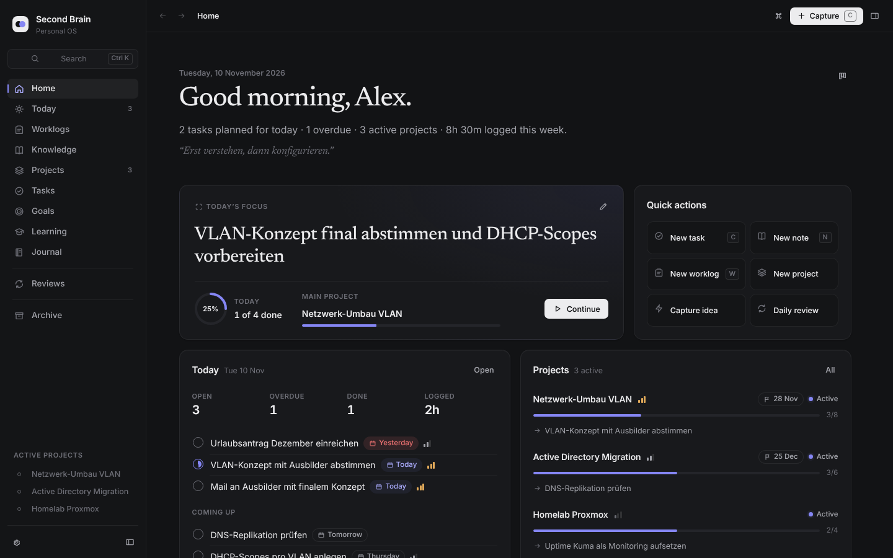
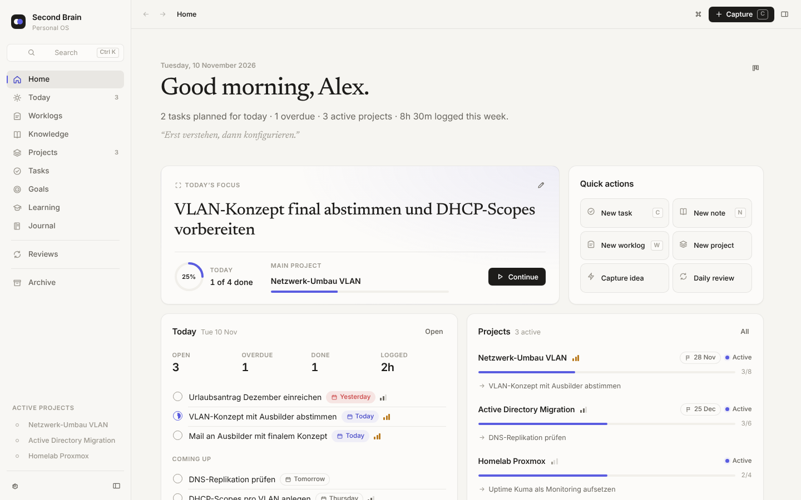
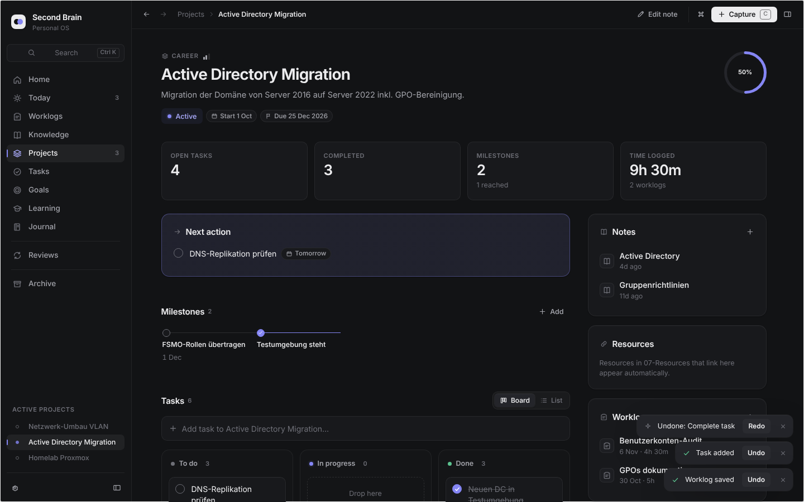
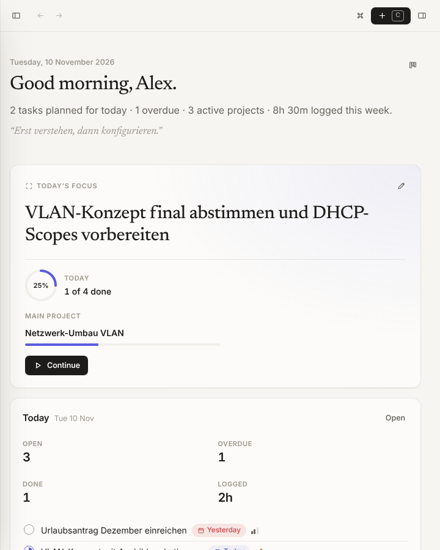
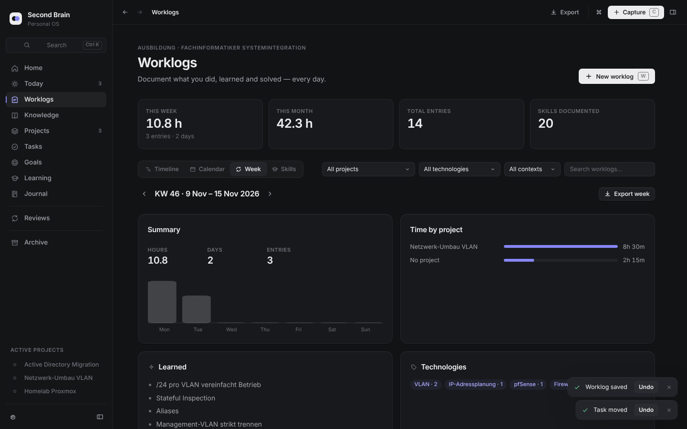
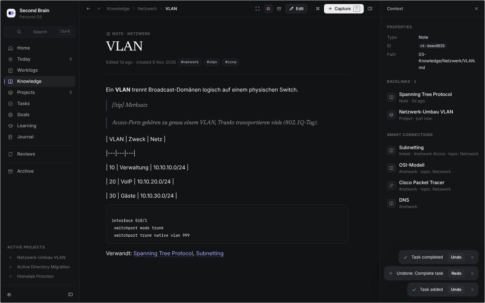

# Second Brain OS

A personal operating system on top of Obsidian: dashboard, tasks, projects, goals, worklogs, knowledge, learning, journal and guided reviews. It has one consistent design language, light and dark modes, and keyboard-first navigation, and it stores everything as **plain Markdown + YAML**.

Obsidian is the engine. Second Brain OS renders its own full-screen app view and hides Obsidian's chrome while the app is active. A single click (**Edit**) takes you to the normal Markdown editor.

```
Second-Brain-OS/
├── Vault/                         ← open this folder in Obsidian (ready to use, with demo data)
│   ├── .obsidian/plugins/second-brain-core/   built plugin (main.js, styles.css, manifest.json)
│   ├── .obsidian/themes/Second Brain/         matching editor theme
│   ├── 00-System/  01-Daily/  02-Worklogs/  03-Knowledge/  04-Projects/
│   └── 05-Goals/   06-Journal/  07-Resources/  08-Archive/
├── Development/                   ← plugin source (TypeScript, strict)
│   ├── src/core/        data models, schema, store, actions, queries, search, parsers
│   ├── src/services/    VaultPort implementations (Obsidian, in-memory)
│   ├── src/ui/          design-system components, icons, motion
│   ├── src/views/       app shell + pages (one file per module)
│   ├── src/styles/      design tokens + component CSS
│   ├── src/theme/       Obsidian theme
│   ├── tests/           unit, performance and end-to-end tests
│   ├── preview/         browser harness running the real app on an in-memory vault
│   └── scripts/         build + demo-data generator
└── docs/                ARCHITECTURE · DATA-MODEL · USER-GUIDE · LIMITATIONS · TESTING
```

## Install

### Option A — use the bundled vault (quickest)
1. Open Obsidian → *Open folder as vault* → choose `Second-Brain-OS/Vault`.
2. Obsidian asks whether you trust the vault's plugins → **Trust author and enable plugins**. This is needed because the vault ships its own plugin.
3. The app opens automatically. If it doesn't: ribbon icon (brain) or command palette → *Second Brain OS: Open Second Brain*.
4. The demo data is marked `sbos-testdata: true`. Remove it when you're ready: command palette → *Remove demo / test data*. That moves only those files to the trash.

### Option B — add it to your existing vault
**Make a backup of your vault first** (copy the folder). The plugin never rewrites existing notes on install, but a backup is good practice.

1. Copy `Vault/.obsidian/plugins/second-brain-core/` to `<your vault>/.obsidian/plugins/`.
2. Optional: copy `Vault/.obsidian/themes/Second Brain/` to `<your vault>/.obsidian/themes/`, then pick it under *Settings → Appearance → Themes*.
3. *Settings → Community plugins* → enable **Second Brain OS**.
4. Run *Second Brain OS: Create missing vault folders (safe)*. It only creates folders and the inbox that don't exist yet. If your folders are named differently, map them under *Settings → Second Brain OS → Folders* instead.
5. Optional: run *Create full backup of vault notes*, which copies every note to `.sbos/full-backups/<timestamp>/`.

Existing notes show up immediately: any Markdown file without a `type` counts as a knowledge note, and checkbox lines anywhere are tasks.

## Build from source

Requirements: Node 18+ (tested with Node 22).

```bash
cd Second-Brain-OS/Development
npm install
npm run build        # typecheck + bundle → writes into ../Vault/.obsidian/plugins/second-brain-core and the theme
npm run dev          # watch mode (inline sourcemaps)
npm test             # unit + performance tests (vitest)
npm run e2e          # builds the browser preview and runs the Playwright end-to-end suite
node tests/e2e/plugin.e2e.mjs   # plugin entry against an Obsidian API mock
node scripts/seed-demo.mjs [--vault <path>] [--today YYYY-MM-DD] [--clean]   # (re)generate or remove demo data
```

To develop against your own vault, symlink or copy `Vault/.obsidian/plugins/second-brain-core` into it and reload Obsidian (or use the *Hot Reload* community plugin).

`npm run preview` builds `preview/dist/index.html`. It's the real app shell, store and actions running on an in-memory copy of the demo vault, and it's useful for UI work without Obsidian. URL params: `?theme=light`, `?route=projects`.

## Documentation
- **[User guide](docs/USER-GUIDE.md)**: daily workflow, modules, keyboard shortcuts
- **[Data model](docs/DATA-MODEL.md)**: every file format and property
- **[Architecture](docs/ARCHITECTURE.md)**: modules, public interfaces, performance design
- **[Limitations](docs/LIMITATIONS.md)**: what is not done or not verified, including mobile
- **[Testing](docs/TESTING.md)**: what was actually tested and the results

## Screenshots
Generated by the end-to-end suite (`npm run e2e`) from the demo vault.

| Dark | Light |
|---|---|
|  |  |
|  |  |
|  |  |
